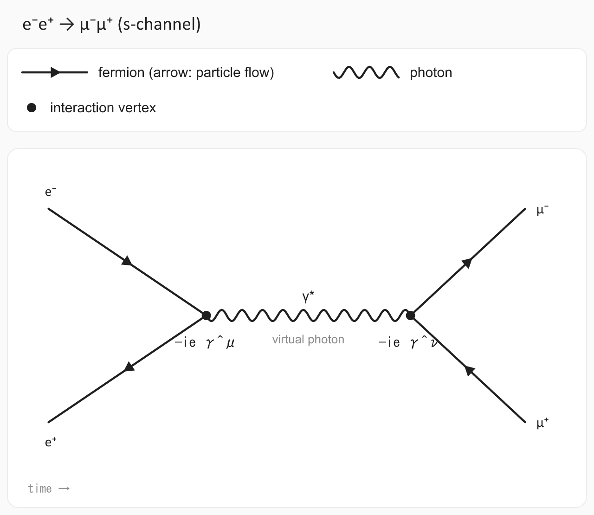
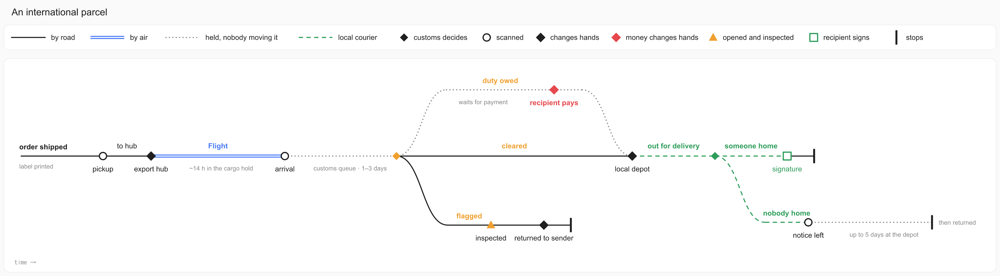

# feynman-diagram

[](https://skills.sh/EthanThatOneKid/feynman-diagram)

An Agent Skill (`/feynman-diagram`) that draws any process, in any domain, as a Feynman-style diagram. Time runs left to
right. A line's stroke says **what carries** that stretch, and a vertex's glyph says **what kind of event** happens
there. Each diagram defines its own vocabulary, or starts from a preset.

| particle physics (`qed` preset)               | an agent workflow (`agent` preset)         |
| --------------------------------------------- | ------------------------------------------ |
|  |  |



The agent writes a small JSON spec: the vocabulary (line kinds, vertex kinds, and what each means) and the timeline.
[`render.ts`](skills/feynman-diagram/scripts/render.ts) lays it out and emits an SVG that supports light and dark mode,
plus a PNG with `--png`.

- **Line strokes:** solid, wave, coil, zigzag, dashed, dotted, double, optionally with direction arrows.
- **Vertex glyphs:** circle, diamond, square, triangle, hexagon, star, cross, dot, bar; solid or hollow.
- **Colors:** nine palette tokens that adapt to dark mode, or any hex value.
- **Structure:** triggers, merges, branches, detours that rejoin, approval loops, and physics-style symmetric legs.

## Install

With the [`skills`](https://skills.sh) CLI:

```sh
npx skills add EthanThatOneKid/feynman-diagram
```

Or copy or symlink `skills/feynman-diagram/` into your agent's skills directory:

```sh
# Claude Code (user-level)
ln -s "$PWD/skills/feynman-diagram" ~/.claude/skills/feynman-diagram
```

Then ask for `/feynman-diagram <thing to diagram>`. Rendering requires [Deno](https://deno.com).

## Render by hand

```sh
deno task render examples/package-shipment.json --png examples/package-shipment.png
deno task examples   # re-render every example
deno task test
```

The spec format is in [`references/spec.md`](skills/feynman-diagram/references/spec.md).

## Provenance

The `agent` preset follows a hand-drawn diagram of an inbox-triage agent by Sam Collins
([@smcllns](https://x.com/smcllns/status/2122390025816207504)), which
[`examples/inbox-triage.json`](examples/inbox-triage.json) recreates. The split between Substance and Style, where the
agent writes semantics and the renderer owns geometry, comes from Wen et al.,
[_Feynman: Knowledge-Infused Diagramming Agent for Scalable Visual Designs_](https://arxiv.org/abs/2603.12597) (CMU,
2026).
