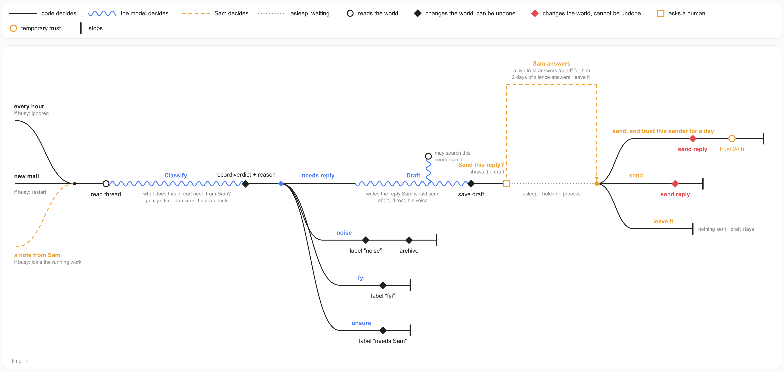

# feynman-diagram

An Agent Skill (`/feynman-diagram`) that draws a concept, architecture, or agent as a Feynman-style timeline. Time runs
left to right. A line's stroke says **who decides** that stretch, and a vertex says **what that moment does to the
world**.



| stroke        | who decides             |   | glyph    | effect                              |
| ------------- | ----------------------- | - | -------- | ----------------------------------- |
| solid         | code                    |   | ○        | reads the world                     |
| wave          | the model               |   | ◆ black  | changes the world, can be undone    |
| dashed orange | a human                 |   | ◆ red    | changes the world, cannot be undone |
| dotted gray   | nobody: asleep, waiting |   | □ orange | asks a human                        |
|               |                         |   | ○ orange | temporary trust                     |
|               |                         |   | ┃        | stops                               |

The agent writes a small JSON spec (semantics only). [`render.ts`](skills/feynman-diagram/scripts/render.ts) lays it out
and emits a themeable SVG, plus a PNG with `--png`. It supports light and dark mode.

## Install

Copy or symlink `skills/feynman-diagram/` into your agent's skills directory:

```sh
# Claude Code (user-level)
ln -s "$PWD/skills/feynman-diagram" ~/.claude/skills/feynman-diagram
```

Then ask for `/feynman-diagram <thing to diagram>`. Rendering requires [Deno](https://deno.com).

## Render by hand

```sh
deno task render examples/inbox-triage.json            # -> examples/inbox-triage.svg
deno task render examples/inbox-triage.json --png examples/inbox-triage.png
```

The spec format is in [`references/spec.md`](skills/feynman-diagram/references/spec.md).

## Provenance

The notation follows a hand-drawn diagram of an inbox-triage agent, which
[`examples/inbox-triage.json`](examples/inbox-triage.json) recreates. The split between Substance and Style, where the
agent writes semantics and the renderer owns geometry, comes from Wen et al.,
[_Feynman: Knowledge-Infused Diagramming Agent for Scalable Visual Designs_](https://arxiv.org/abs/2603.12597) (CMU,
2026).
